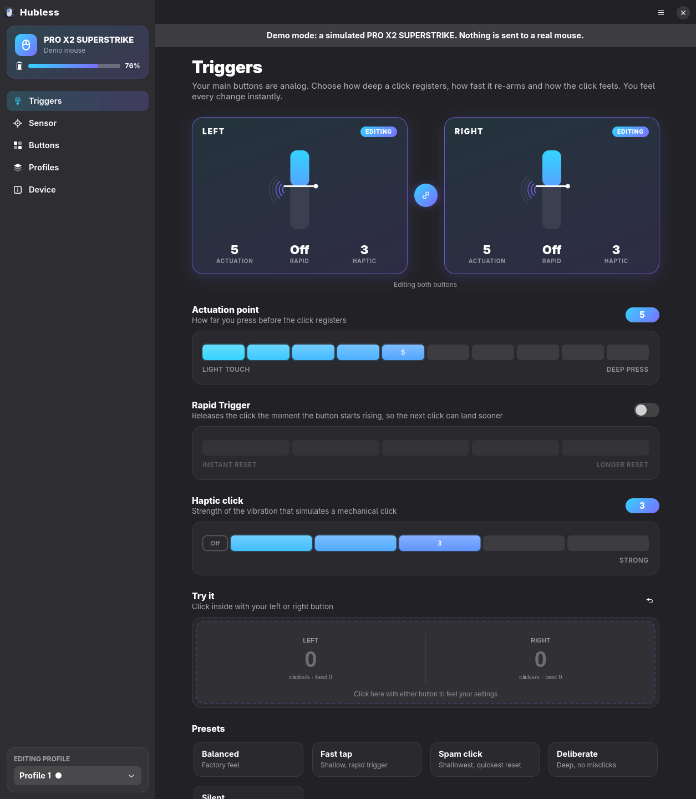
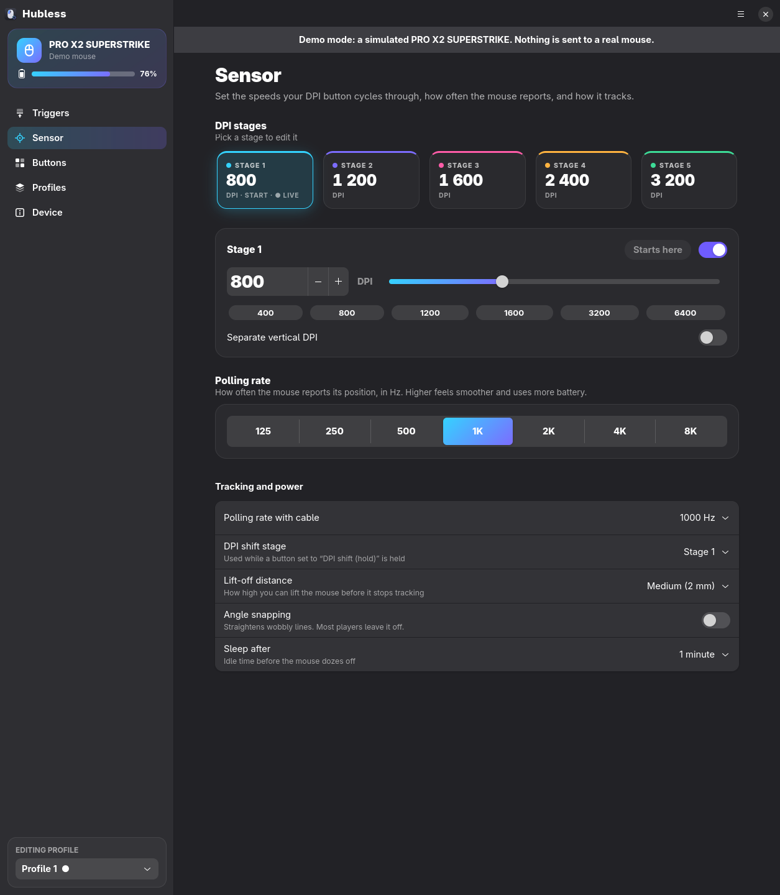
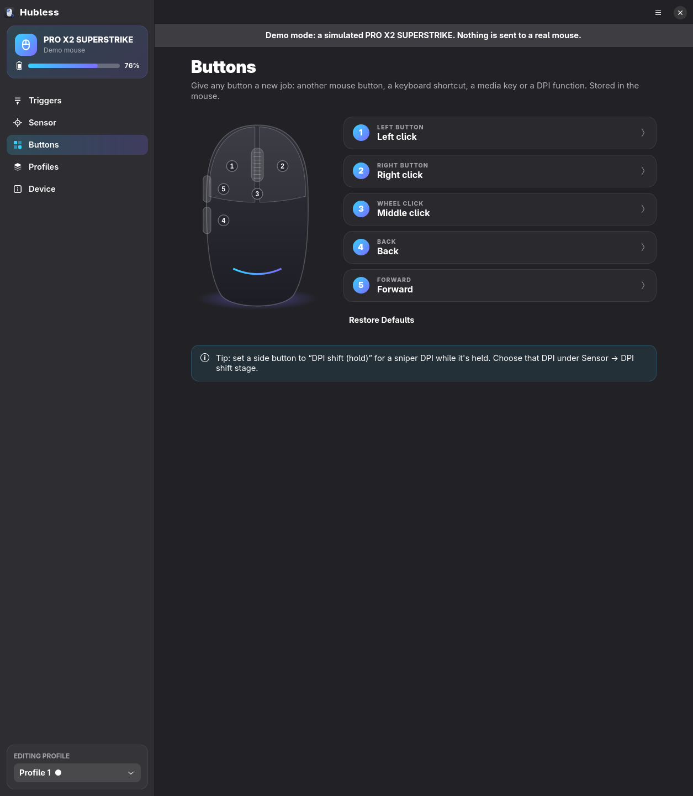
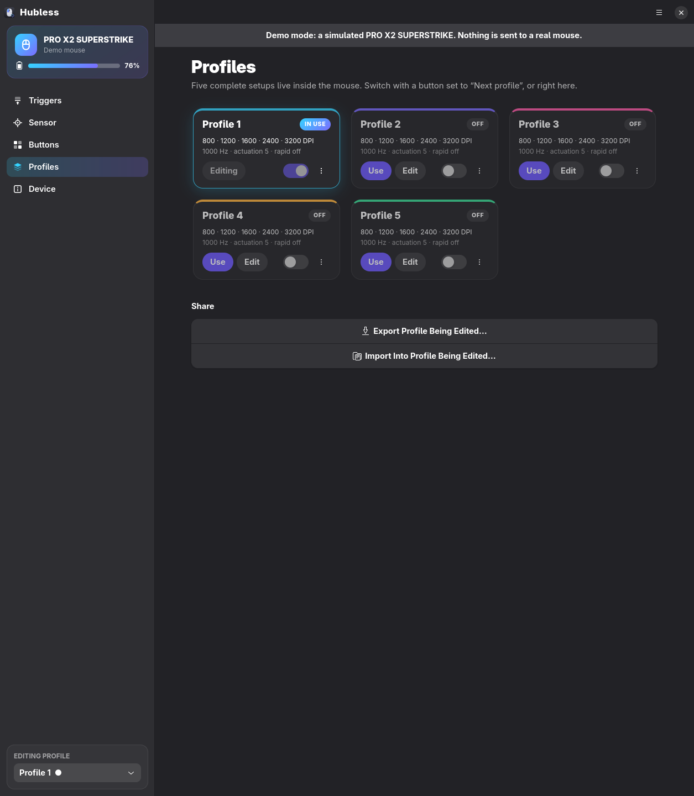
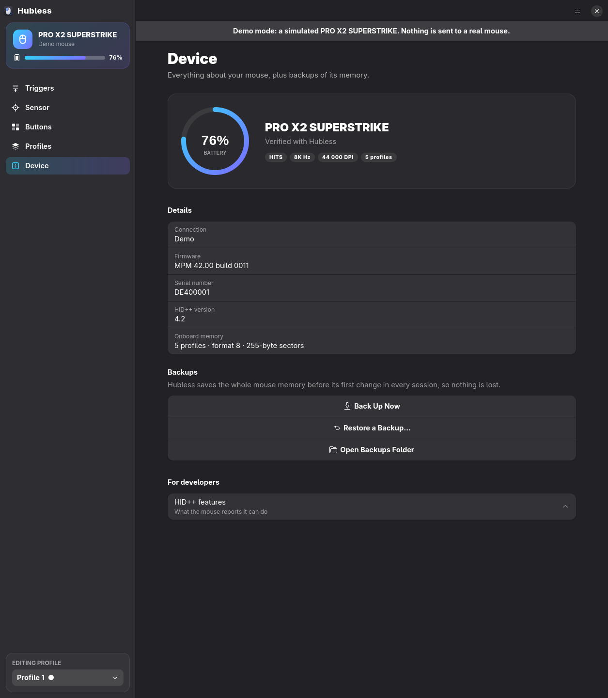

<div align="center">


# Hubless

**Logitech G mouse settings for Linux.**
DPI, polling rate, button actions, onboard profiles, and the HITS analog triggers of the
PRO X2 / X3 SUPERSTRIKE: actuation point, rapid trigger and haptic click.

</div>



Logitech G HUB doesn't run on Linux. Hubless is a small native GTK app that talks to the mouse
directly over HID++, and writes everything into the mouse's **onboard memory**. Close the app and your
settings stay: in games, on other computers, even on Windows.

## Why Hubless

- **Verified on a real PRO X2 SUPERSTRIKE**: every write path was checked byte for byte against the
  hardware, and polling rates of 500, 1000 and 2000 Hz were confirmed by timing real input reports.
- **Rapid trigger that actually toggles.** Hubless knows the low bit of the rapid-trigger byte is the
  on/off switch, not a flag to preserve.
- **DPI that really changes.** DPI stages are 5-byte `[X, Y, lift-off]` entries. Tools that wrote 16-bit words
  from byte 3 reported success while the sensor never changed.
- **DPI values the sensor accepts.** The sensor's DPI list has a different step per range (1 below 200 DPI,
  200 near 44 000), and Hubless snaps to it instead of sending values that get rejected.
- **Changes save themselves.** Move a slider and it's felt immediately and stored in the mouse
  ("Saved to mouse" in the header). There's no Apply button to forget.
- **Can't brick your setup.** The whole profile memory is backed up before the first change of every
  session, every write is read back and compared, and any backup can be restored from the menu.
  Remapping away your last left click asks first.
- **No terminal needed.** On first start Hubless asks for permission with the normal system password
  prompt and installs the access rule itself.
- **Knows when the mouse is asleep**, instead of saying "no device found", and waits for it to wake.
- **G HUB HITS codes**: paste a code from G HUB or a pro player, or share yours.
- **Nothing running in the background.** No daemon, no tray icon, no telemetry, no account.

## Features

| | |
|---|---|
| **Triggers** (SUPERSTRIKE) | Actuation point 1–10, rapid trigger on/off and reset distance 1–5, haptic strength 0–5, per button or both, live click-test pad, presets, HITS codes |
| **Sensor** | Five DPI stages (100–44 000) with on/off and starting stage, separate X/Y, DPI-shift stage, lift-off distance, angle snapping, wireless and wired polling rate (up to 8000 Hz), sleep timer |
| **Buttons** | Mouse buttons, keyboard shortcuts (record by pressing them), media keys, DPI/profile functions, disable |
| **Profiles** | Five onboard profiles: switch, turn on/off, rename, copy, reset to factory (from the mouse's own ROM), export/import |
| **Device** | Battery, firmware, serial number, backups, HID++ feature list |

| Sensor | Buttons |
|---|---|
|  |  |
| **Profiles** | **Device** |
|  |  |

## Supported mice

| Mouse | Status |
|---|---|
| PRO X2 SUPERSTRIKE (LIGHTSPEED receiver) | **Verified** — every feature tested on hardware |
| PRO X3 SUPERSTRIKE | Same protocol and memory format; should work, reports welcome |
| Other Logitech G mice with onboard profiles (G502 X, G PRO X SUPERLIGHT, G305, G703, …) | Experimental: DPI, polling rate, buttons and profiles use the common G-series format. A backup is always made first |

Run `hubless --status` and open an issue with the output if your mouse isn't listed.

## Install

You need Python 3.10+, PyGObject, GTK 4 and libadwaita 1.7+ (any 2025+ distro).

```sh
# Arch / Manjaro / CachyOS / Omarchy
sudo pacman -S python-gobject gtk4 libadwaita
# Fedora
sudo dnf install python3-gobject gtk4 libadwaita
# Debian 13 / Ubuntu 25.04+
sudo apt install python3-gi gir1.2-gtk-4.0 gir1.2-adw-1

git clone https://github.com/hubless-app/hubless && cd hubless
./install.sh            # installs for your user; Hubless appears in your app launcher
```

On first start Hubless asks for your password once to install a udev rule
(`/etc/udev/rules.d/70-hubless.rules`) that lets your user, and only your logged-in user, talk to Logitech
devices. To do that step yourself: `sudo ./install.sh --udev`.

Arch users can build the package in `packaging/arch/PKGBUILD`, which also installs the rule.
Try the app without a mouse: `hubless --demo`.

## Command line

```sh
hubless --status                          # battery, DPI stages, HITS, buttons
hubless --dpi 1600                        # DPI of the starting stage
hubless --actuation 3 --rapid-trigger 2   # HITS on both buttons (rapid trigger level 2)
hubless --rapid-trigger off --haptics 0
hubless --hits-code MDAwNDA1MDMwNTEwMDQwMw==
```

## FAQ

**Do I need to keep Hubless running?** No. Everything is stored in the mouse.

**Can I use it next to Solaar?** Yes, but don't change the same mouse in both at once. If another tool put
the mouse in "host mode", Hubless switches it back to its onboard profiles and tells you.

**Something went wrong. How do I undo it?** Main menu → *Restore a backup…*. Backups are in
`~/.local/share/hubless/backups/`. Each profile can also be reset to factory settings from its menu.

**Is this affiliated with Logitech?** No. Logitech, G HUB, LIGHTSPEED, PRO and SUPERSTRIKE are trademarks of
Logitech, used here only to name the hardware.

## How it works

Hubless speaks HID++ 2.0 to the mouse through `/dev/hidraw` (the receiver's vendor interface), resolves
features from the mouse's own feature table, and edits onboard profile sectors in place, so unknown
bytes are never touched. See [`docs/PROTOCOL.md`](docs/PROTOCOL.md) for the verified memory layout and
everything learned along the way.

Protocol knowledge builds on [Solaar](https://github.com/pwr-Solaar/Solaar),
[libratbag](https://github.com/libratbag/libratbag), and the SUPERSTRIKE research by
[kazehana99k](https://github.com/kazehana99k/Logitech-PRO-X2-SUPERSTRIKE-Linux-haptics-actuation-control-)
and [SuperStrike Studio](https://github.com/Adhamura/superstrike-studio). Thank you.

## Development

```sh
python3 -m hubless --demo        # simulated mouse
python3 tests/test_protocol.py   # codec tests, no hardware
python3 tests/gui_flow.py        # drives the real UI against the simulator
python3 tests/hardware.py        # full check on a real SUPERSTRIKE (restores memory afterwards)
python3 tools/screenshots.py docs/screenshots
```

MIT licensed.
