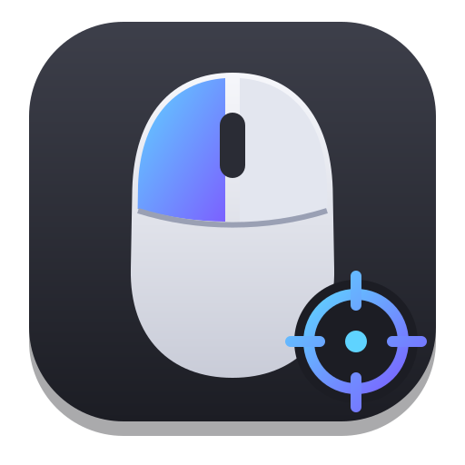
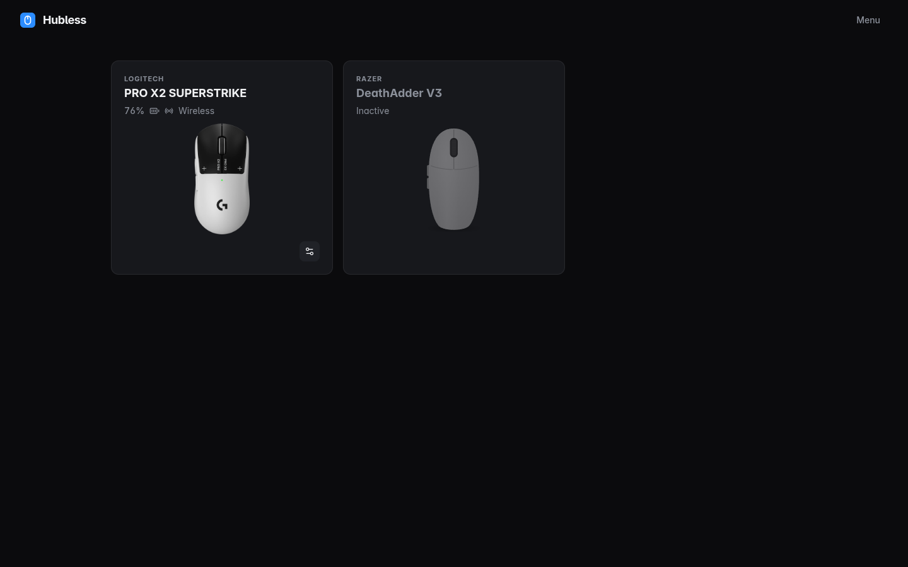
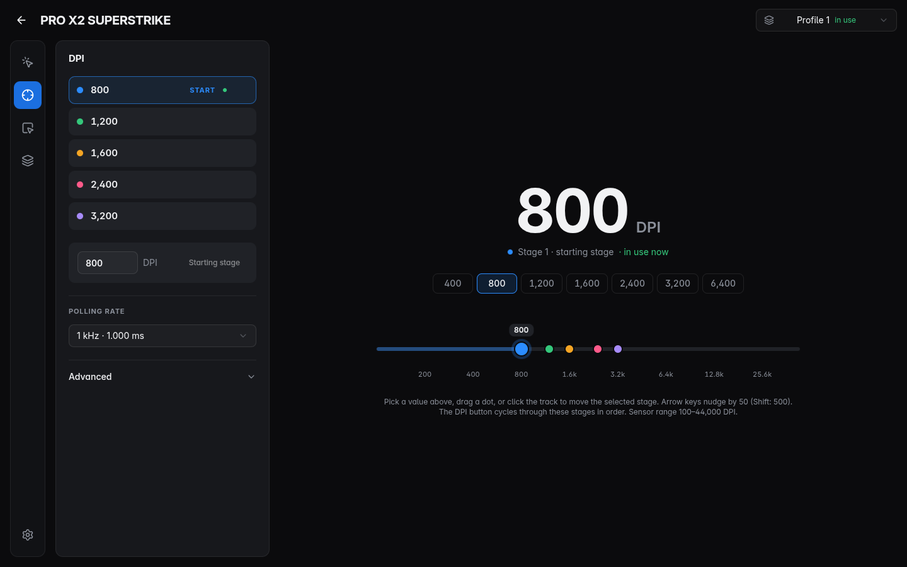
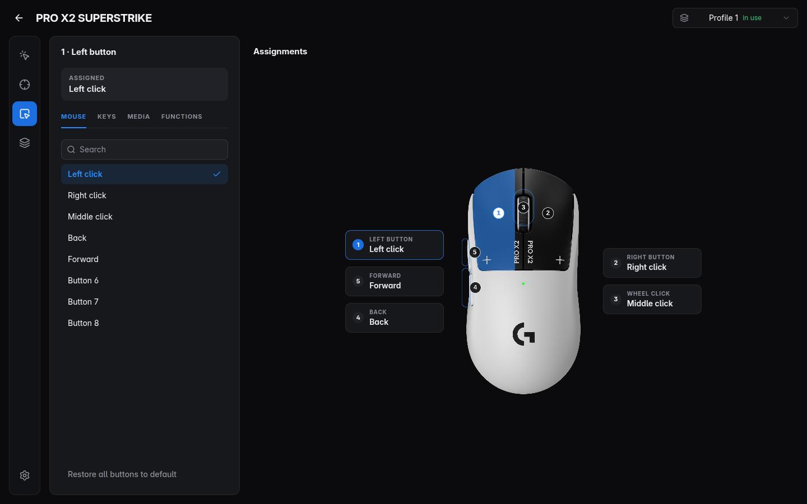
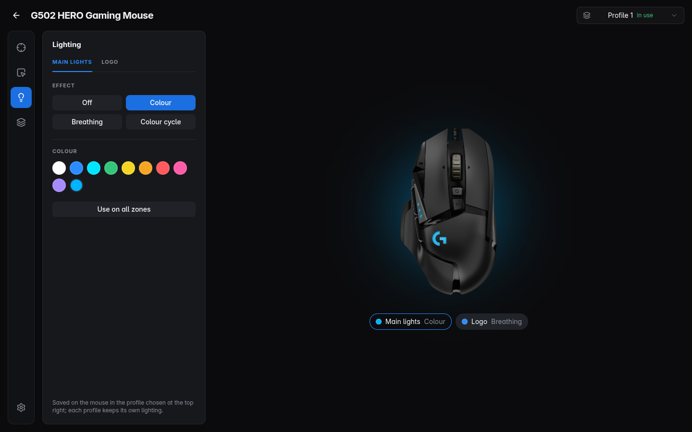
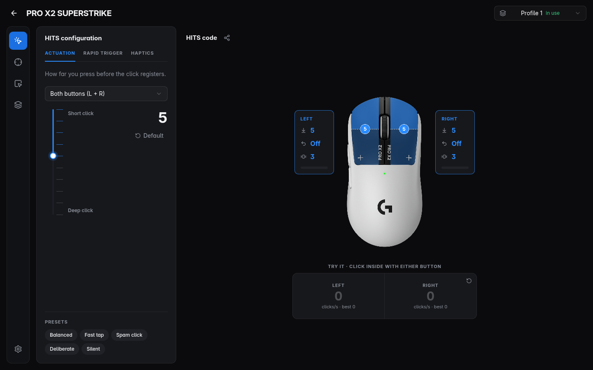
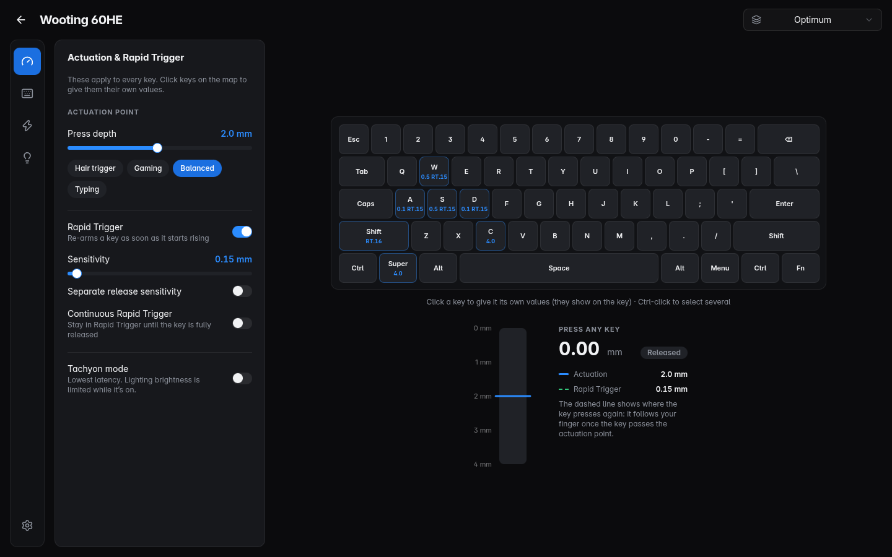

<div align="center">



# Hubless

**Settings for gaming mice, keyboards and headsets on Linux.**
One app for the things G HUB, Synapse, Wootility and Adjust usually do, talking to the devices directly and saving
into their own memory.

</div>



| Sensor & DPI | Buttons |
|---|---|
|  |  |
| **Lighting** | **Triggers (PRO X2 SUPERSTRIKE)** |
|  |  |



<sub>The mouse screenshots are from the built-in demo (`hubless --demo`), which simulates these mice. The keyboard one
is a real Wooting 60HE.</sub>

<div align="center">

**[⬇ Download the latest release](https://github.com/Ynnad242/hubless/releases/latest)** · [Supported devices](DEVICES.md) · [Roadmap](ROADMAP.md) · [Report a problem](https://github.com/Ynnad242/hubless/issues) · Free and open source, forever

</div>

## Download and install

1. Open the **[latest release](https://github.com/Ynnad242/hubless/releases/latest)** and download the file for your Linux:

   | Your Linux | Download | Install it with |
   |---|---|---|
   | Arch, Manjaro, EndeavourOS, CachyOS, Omarchy | `hubless-<version>.pacman` | `sudo pacman -U ~/Downloads/hubless-*.pacman` |
   | Ubuntu, Debian, Linux Mint, Pop!_OS, Zorin | `hubless_<version>_amd64.deb` | `sudo apt install ~/Downloads/hubless_*_amd64.deb` |
   | Fedora, Nobara, Bazzite (layered), RHEL | `hubless-<version>.x86_64.rpm` | `sudo dnf install ~/Downloads/hubless-*.x86_64.rpm` |
   | openSUSE | `hubless-<version>.x86_64.rpm` | `sudo zypper install ~/Downloads/hubless-*.x86_64.rpm` |
   | Anything else | `Hubless-<version>.AppImage` | see [AppImage](#appimage) below |

   Not sure which one you have? Run `cat /etc/os-release` in a terminal and look at the `NAME` line.

2. **Open Hubless** from your app launcher (or type `hubless` in a terminal).

3. **Plug in your mouse, keyboard or headset.** It shows up on the home screen within a few seconds. Click the
   settings button on its card to configure it. Wireless Logitech mice may say "Asleep": move the mouse to wake it.

That's it. The packages above also install a small system rule
(`/usr/lib/udev/rules.d/70-hubless.rules`) that lets your user talk to supported devices without root, so you never
have to run Hubless with `sudo`, and the update helper described in [Updating](#updating).

### AppImage

The AppImage runs without installing, on any distribution:

```sh
chmod +x ~/Downloads/Hubless-*.AppImage
~/Downloads/Hubless-*.AppImage
```

It needs FUSE 2: `sudo pacman -S fuse2` (Arch), `sudo apt install libfuse2t64` (Ubuntu 24.04+) or
`sudo apt install libfuse2` (older Ubuntu / Debian). On first start Hubless shows **“Allow Hubless to talk to your
devices”**: click the button and enter your password once. Unplug and replug the device afterwards if it doesn't show
up straight away.

### Updating

You only download Hubless once. Every time it starts, it checks GitHub for a new release. If there is one, it shows
**Updating Hubless**, downloads it (verified against the release's checksums), installs it and reopens by itself. If
there isn't, it just opens. While it keeps running in the tray it checks again every few hours and installs quietly in
the background.

No password is needed for this. The `.pacman`, `.deb` and `.rpm` packages include a small root-owned helper
(`/usr/lib/hubless/hubless-update`) that your user may run without a password. It only installs a file whose
checksum matches the latest Hubless release on GitHub, so it can't be used to install anything else. The AppImage
simply replaces its own file.

Your settings, device list, photos and backups are kept, and so are the settings stored in your devices. You can see
your version, check for updates or turn **Update automatically** off in ⚙ Settings → Updates.

### Uninstalling

`sudo pacman -R hubless`, `sudo apt remove hubless` or `sudo dnf remove hubless` (AppImage: delete the file). This
removes the app and its system rule. Your settings and device backups stay in your home folder until you delete them
in **⚙ Settings → Delete all Hubless data**, or by hand (see [PRIVACY.md](PRIVACY.md)). Settings saved inside your
devices stay on the devices.

### Troubleshooting

- **My device isn't listed.** Check [the device list](DEVICES.md). Devices marked "support coming soon"
  are recognised but can't be configured yet. Otherwise unplug and replug it, and if it still doesn't appear,
  [open an issue](https://github.com/Ynnad242/hubless/issues) with the output of `lsusb`.
- **The “Allow Hubless” banner keeps coming back.** Log out and back in once, or press ⚙ Settings → Grant access again.
- **Changes don't stick.** Close other tools that talk to the same device (Solaar, Piper, OpenRazer's daemon,
  Wootility in a browser) while you use Hubless.
- **“Couldn't update: pkexec must be setuid root”.** Versions before 0.20.2 could not install a second update without
  being reopened. Quit Hubless (tray icon → Quit) and open it again from your app launcher; the update then installs.
- **Something went wrong.** Every device page has *Restore a backup…*; a backup is made before the first change of
  every session.

## Supported devices

**[See the full list of supported devices →](DEVICES.md)**

| Device | What works | Status |
|---|---|---|
| Logitech PRO X2 SUPERSTRIKE | HITS triggers, DPI stages, polling, buttons, 5 onboard profiles | ✅ Tested on hardware |
| Endgame Gear OP1 8k | DPI, polling up to 8 kHz, lift-off, angle snap, motion sync, ripple, debounce, buttons | ✅ Tested on hardware |
| WLmouse Ying (cable) | DPI stages, polling, lift-off, angle snap, motion sync, ripple, debounce | ✅ Tested on hardware |
| Wooting 60HE | Actuation, rapid trigger, per-key settings, key mapping, Mod-Tap / Snap Tap, lighting | ✅ Tested on hardware |
| Fractal Design Scape | Battery, EQ, noise cancelling, sidetone, lighting | ✅ Tested on hardware |
| 52 other Logitech G mice | DPI, polling, buttons, onboard profiles, RGB lighting (G502, G203, G Pro and others with RGB) | 🧪 Should work, untested |
| 74 Razer mice (Viper, DeathAdder, Basilisk, Cobra, Naga…) | DPI stages, polling up to 8 kHz, battery, RGB lighting on 53 of them | 🧪 Should work, tested on a simulated mouse |

About 85 more devices (SteelSeries, ASUS, Glorious, Roccat, older Razer and more) are recognised by name and marked
"support coming soon"; they can't be configured yet. Own an untested one? **Device settings → Copy device report**
(or the card's ⋯ menu) copies a read-only report to paste into an issue. [DEVICES.md](DEVICES.md) lists every one.

## What to expect

- **Settings live in the device.** Changes are saved into the device's onboard memory as you make them, so they keep
  working in games, on other computers and without Hubless running. One exception: Razer mice can't report
  their lighting back, so Hubless remembers the lighting it last set in your home folder to show it again.
- **Backups first.** The device memory is backed up before the first change of every session, writes are read back
  and compared, and backups can be restored from the device page.
- **Use at your own risk.** Hubless writes to device memory using protocols worked out from public research and from
  testing on the devices listed above. That has worked reliably on the tested hardware, but it is not the
  manufacturers' software and comes without warranty (see LICENSE).
- **Firmware updates where the maker allows them.** Devices whose makers publish firmware for Linux (through fwupd)
  can be updated from the device page, after a settings backup. Wooting keyboards are handed to Wootility for updates.
  Logitech G, Razer, Endgame Gear, WLmouse and Fractal Design only ship firmware through their own Windows or macOS
  apps, so for those Hubless shows the installed version and names the app you need. Hubless never writes firmware
  itself.
- **Keeps running in the tray** if you want it to (for low-battery warnings). This can be turned off in Settings.

## Privacy

Hubless has no accounts, analytics or telemetry. Its only network use is checking GitHub for new versions, which you can
turn off in Settings. Everything it stores is in your home folder and can be deleted from Settings. Details: [PRIVACY.md](PRIVACY.md).

## Build from source

You need Node.js 22+ and npm.

```sh
git clone https://github.com/Ynnad242/hubless.git && cd hubless
npm install
npx electron-vite build
npx electron-builder --linux pacman     # or AppImage, deb, rpm → dist/
```

Try it without hardware: `hubless --demo` (or `npx electron . --demo` from the source folder) shows four
simulated mice: Logitech PRO X2 SUPERSTRIKE and G502 HERO, Razer Viper V3 Pro and Basilisk V3 Pro.

## Development

```sh
npm run dev                                   # app with hot reload
npx tsc --noEmit -p tsconfig.json             # typecheck
npx vitest run                                # unit tests (no hardware)
HUBLESS_HW=1 npx vitest run test/hardware.test.ts       # real Logitech mouse, restores memory afterwards
HUBLESS_HW=1 npx vitest run test/peripherals.test.ts    # real Wooting + Scape, restores afterwards
HUBLESS_SHOTS=docs/screenshots npx electron . --demo    # screenshots (after a build)
node tools/third-party-notices.mjs            # refresh THIRD_PARTY_NOTICES.md after dependency changes
node tools/devices-page.mjs                   # refresh DEVICES.md after changing data/mice.json or data/razer.json
python3 -I tools/extract-razer.py <openrazer>/driver data/razer.json   # per-model Razer protocol facts
```

Protocol notes: [docs/PROTOCOL.md](docs/PROTOCOL.md). The mouse catalog is generated by `tools/build-catalog.py`.

## Credits and legal

Protocol knowledge builds on Solaar, libratbag, OpenRazer, egctl, OpenMouse, scapectl, Wooting protocol notes and the
SUPERSTRIKE research by kazehana99k and SuperStrike Studio; see [THIRD_PARTY_NOTICES.md](THIRD_PARTY_NOTICES.md) for
those credits and the licenses of bundled libraries.

Hubless is not affiliated with, endorsed by or sponsored by Logitech, Razer, Wooting, Fractal Design, Endgame Gear,
WLmouse or any other manufacturer. Product names and brands belong to their owners and are used only to identify compatible
hardware. Product photos in `data/devices/` belong to and are credited to their manufacturers (Logitech, Razer, Wooting,
Fractal Design, Endgame Gear, WLmouse, Glorious). They are not covered by the MIT license, are used only to show which hardware is supported, and
will be removed on request through an [issue](https://github.com/Ynnad242/hubless/issues).

Hubless is free and always will be. It is MIT licensed.
