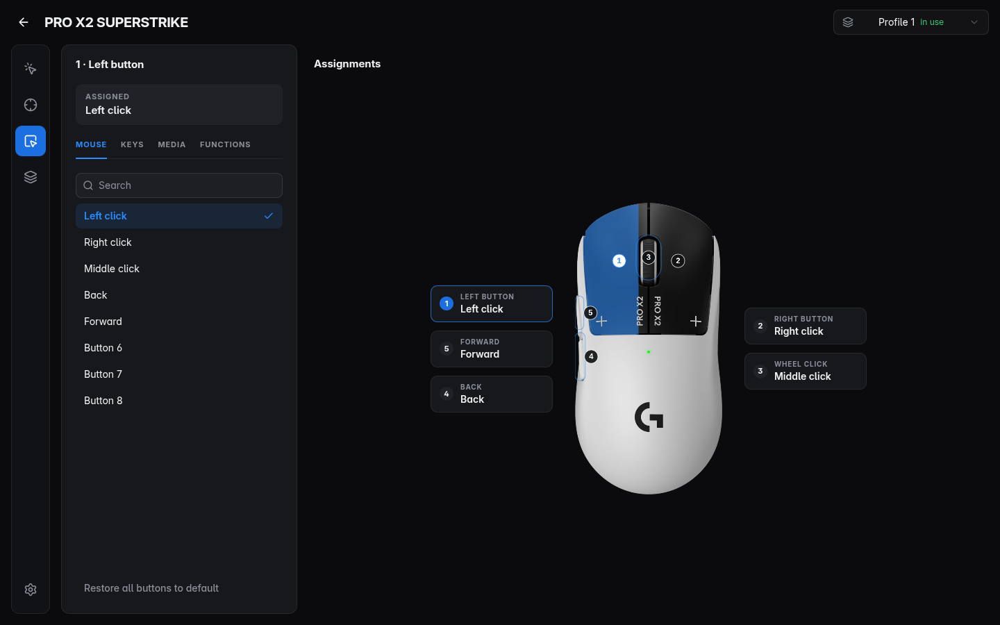

<div align="center">


# Hubless

**Settings for gaming mice, keyboards and headsets on Linux.**
One app for the things G HUB, Synapse, Wootility and Adjust usually do, talking to the devices directly and saving
into their own memory.

</div>


| Sensor & DPI | Buttons |
|---|---|
|  |  |

## Supported devices

| Device | What works | Status |
|---|---|---|
| Logitech PRO X2 SUPERSTRIKE | HITS triggers (actuation, rapid trigger, haptics, live press depth), DPI stages, polling, buttons, 5 onboard profiles, backups | Tested on hardware |
| Other Logitech G mice with onboard profiles | DPI, polling, buttons, profiles (common G-series format) | Untested — a backup is made first |
| Wooting 60HE | Actuation, rapid trigger, Tachyon, per-key actuation and RT, live key travel, key mapping (3 layers), Mod-Tap / Toggle / Snap Tap, lighting, rename | Tested on hardware |
| Fractal Design Scape | Battery, EQ presets and custom EQ, EQ codes, noise cancelling, sidetone and its volume, lighting on/off | Tested on hardware |
| Endgame Gear OP1 8k (`3367:1964`) | DPI levels, polling up to 8 kHz, lift-off, angle snapping, motion sync, ripple control, click filters, debounce, buttons | Tested on hardware |

Hubless also recognises about 200 more mice (Razer, SteelSeries, ASUS, Glorious, Roccat, Endgame Gear and more) by
their USB id and shows them by name, marked "support coming soon". They can't be configured yet.

## What to expect

- **Settings live in the device.** Changes are saved into the device's onboard memory as you make them, so they keep
  working in games, on other computers and without Hubless running.
- **Backups first.** The device memory is backed up before the first change of every session, writes are read back
  and compared, and backups can be restored from the device page.
- **Use at your own risk.** Hubless writes to device memory using protocols worked out from public research and from
  testing on the devices listed above. That has worked reliably on the tested hardware, but it is not the
  manufacturers' software and comes without warranty (see LICENSE).
- **Keeps running in the tray** if you want it to (for low-battery warnings). This can be turned off in Settings.

## Install

Arch Linux and derivatives: build the package and install it.

```sh
npm install
npx electron-vite build && npx electron-builder --linux pacman
sudo pacman -U dist/hubless-*.pacman
```

The package installs a udev rule (`/usr/lib/udev/rules.d/70-hubless.rules`) so the logged-in user can reach supported
devices without root. Other distributions: `npx electron-builder --linux AppImage` (needs libfuse2) or `deb` / `rpm`.

Try it without hardware: `hubless --demo`.

## Privacy

Hubless has no accounts, analytics, telemetry or network access. Everything it stores is in your home folder and can
be deleted from Settings. Details: [PRIVACY.md](PRIVACY.md).

## Development

```sh
npm run dev                                   # app with hot reload
npx tsc --noEmit -p tsconfig.json             # typecheck
npx vitest run                                # unit tests (no hardware)
HUBLESS_HW=1 npx vitest run test/hardware.test.ts       # real Logitech mouse, restores memory afterwards
HUBLESS_HW=1 npx vitest run test/peripherals.test.ts    # real Wooting + Scape, restores afterwards
HUBLESS_SHOTS=docs/screenshots npx electron . --demo    # screenshots (after a build)
node tools/third-party-notices.mjs            # refresh THIRD_PARTY_NOTICES.md after dependency changes
```

Protocol notes: [docs/PROTOCOL.md](docs/PROTOCOL.md). The mouse catalog is generated by `tools/build-catalog.py`.

## Credits and legal

Protocol knowledge builds on Solaar, libratbag, OpenRazer, egctl, scapectl, Wooting protocol notes and the
SUPERSTRIKE research by kazehana99k and SuperStrike Studio; see [THIRD_PARTY_NOTICES.md](THIRD_PARTY_NOTICES.md) for
those credits and the licenses of bundled libraries.

Hubless is not affiliated with, endorsed by or sponsored by Logitech, Razer, Wooting, Fractal Design, Endgame Gear or
any other manufacturer. Product names and brands belong to their owners and are used only to identify compatible
hardware. Product photos in `data/devices/` belong to their owners and are not covered by the MIT license; owners can
ask for removal through an issue.

Hubless itself is MIT licensed.
